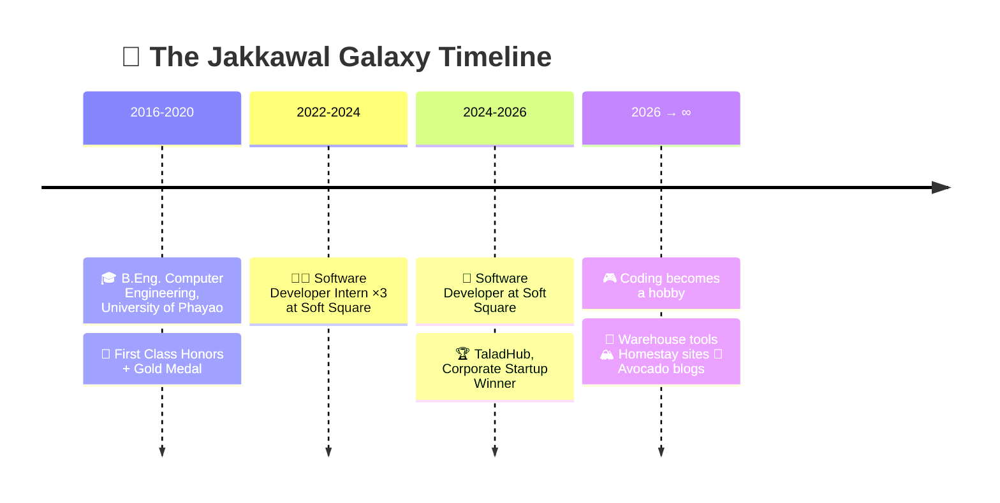

<!-- ═══════════════════════  🌌 HEADER  ═══════════════════════ -->
<p align="center">
  
</p>

<p align="center">
  <a href="https://github.com/Jakkawal23">
    
  </a>
</p>

<p align="center">
  
  
  
  <br/>
  
  
  
  
</p>

---

## 🎬 Plot Twist

> **Season 1:** Gold-medal Computer Engineering grad → 3+ years as a full-time Software Developer → Product Owner of a startup that **won**.
>
> **Season 2:** *quits the job* … opens VS Code anyway. 🫠
>
> Now coding is my **hobby**. No sprint. No stand-up. No Jira.
> Just me, a hardware warehouse, a mountain called **Doi Angkhang**, some avocados, and way too many side projects.



---

## 🧙 Character Sheet

```yaml
name:        Jakkawal Phooluemsai  # จักรวาล ภูเลื่อมใส · 许金宝
alias:       Jakkawal Galaxy
class:       Ex-Developer → Hobby Coder (prestige mode unlocked)
subclass:    Product Owner Mindset
guild:       Soft Square (retired with honors)
home_base:   🔩 a hardware warehouse  |  🏔️ Doi Angkhang
special:     Speaks Chinese to suppliers, TypeScript to computers
weakness:    "just one more feature" at 2 AM
catchphrase: "ใครทำระบบนี้มาว่ะ เท่ชิบ…"
```

| ⚔️ STAT | LEVEL |
| :-- | :-- |
| 🧠 Problem Solving | `██████████` 100 |
| 🎤 Public Speaking | `█████████░` 90 |
| 📦 Product Planning | `█████████░` 90 |
| 🐉 Chinese | `████████░░` 80 |
| 💻 Full-Stack Dev | `████████░░` 80 |
| 🇬🇧 English | `████░░░░░░` 40 *(grinding XP daily)* |
| 😴 Sleep | `█░░░░░░░░░` 10 |

---

## 🏆 Achievements Unlocked

| | Achievement | Rarity |
| :-: | :-- | :-: |
| 🥇 | **Gold Medal + First Class Honors**: B.Eng. Computer Engineering | 🟨 Legendary |
| 🏆 | **Corporate Startup Winner**: TaladHub (Product Owner & Dev) | 🟨 Legendary |
| 🥈 | **Silver Medal**: TESA Top Gun Rally | 🟪 Epic |
| 🚀 | **Top 200 Finalist**: Startup Thailand League | 🟪 Epic |
| 🥇 | **1st Place**: Computer Engineering Project Competition | 🟪 Epic |
| 🎤 | **Pitching Finalist** in various university competitions | 🟦 Rare |
| 👑 | Freshman Class President · Student Union (Tech) · Teaching Assistant | 🟦 Rare |
| 📉 | Cut manual workflows by **50%** with automation | 🟩 Uncommon |
| 🎯 | Built invoice OCR with **95%** extraction accuracy | 🟩 Uncommon |
| 🫠 | Deployed on Friday. Survived. | ⬜ Cursed |

---

## 🗺️ The Multiverse of Side Projects

> Click a world to enter. ⬇️

<details open>
<summary><b>🏔️ WORLD 1 · Doi Angkhang (the mountain where Wi-Fi is weak but code is strong)</b></summary>
<br/>

| Project | Lore | Stack |
| --- | --- | --- |
| [**Angkhang Today**](https://github.com/Jakkawal23/angkhang_today) · [🌐 live](https://angkhangtoday.vercel.app) | All homestays on Doi Angkhang in one place. Filter by route, village, budget and 18 vibes (sea of mist 🌫️, mookata 🥓, heater 🔥). Boss fight: a **"check before you transfer"** page that defeats fake pages & scammers. ⚔️ | Astro · JSON-LD · SEO/AEO |
| [**Yunnan Homestay Room**](https://github.com/Jakkawal23/yunnan-homestay-room) · [🌐 live](https://jakkawal23.github.io/yunnan-homestay-room/) | Pick a date → see free rooms → tap "book" → LINE opens with the message already typed. Staff back office runs on Google Sheets. | HTML · Apps Script · LINE OA |
| [**Yunnan Home Stay**](https://github.com/Jakkawal23/yunnan_home_stay) · [🌐 live](https://yunnan-home-stay.vercel.app) | Landing page for the homestay. | Astro |

</details>

<details>
<summary><b>🔩 WORLD 2 · The Nut & Bolt Dimension (hardware warehouse)</b></summary>
<br/>

| Project | Lore | Stack |
| --- | --- | --- |
| [**HG Hardware**](https://github.com/Jakkawal23/hg_hardware) | Multilingual product catalog + quotation requests for a fastener warehouse. | Next.js · Tailwind · Supabase |
| [**NutWeigh 螺丝秤**](https://github.com/Jakkawal23/fastener-weight-calculator) · [🌐 live](https://jakkawal23.github.io/fastener-weight-calculator/) | *"200 pcs of M8×25?"* → **5.45 斤**. Instantly. Offline. Counting nuts by hand is not a personality. | Vanilla JS |
| [**FastSlip**](https://github.com/Jakkawal23/fast_slip) · [🌐 live](https://jakkawal23.github.io/fast_slip/) | Tax invoices + delivery slips + Excel import/export. **Zero servers.** Zero problems. | Vanilla JS · SheetJS |
| [**Fast Warehouse Order**](https://github.com/Jakkawal23/fast_warehouse_order) | Snap photos, take orders, export PDF. UI in 🇹🇭 🇨🇳 🇬🇧 🇲🇲 | Vanilla JS |
| [**Warehouse Chinese Vocab**](https://github.com/Jakkawal23/hardware_warehouse_chinese_vocabulary) · [🌐 live](https://jakkawal23.github.io/hardware_warehouse_chinese_vocabulary/) | Flashcards: 汉字 + pinyin + Thai for screws, pipes and tools. How I level up my Chinese. | HTML · JS |

</details>

<details>
<summary><b>🥑 WORLD 3 · Avocado Kingdom</b></summary>
<br/>

| Project | Lore | Stack |
| --- | --- | --- |
| [**Avocado Geek**](https://github.com/Jakkawal23/avocado-geek) · [🌐 live](https://avocado-geek.vercel.app) | A blog for Thai avocado growers. Varieties, articles, shops, all in editable JSON. | Next.js |
| [**Avocado Guide**](https://github.com/Jakkawal23/avocado-guide) · [🌐 live](https://avocado-station-guide.vercel.app) | The avocado station guide. | HTML |
| [**Yutthana Farm Product**](https://github.com/Jakkawal23/yutthana_farm_product_mvp) · [🌐 live](https://yutthana-farm-product.vercel.app) | Farm shop running inside LINE. | LINE LIFF |

</details>

<details>
<summary><b>🤖 WORLD 4 · The AI Lab (where the robots read meters so I don't have to)</b></summary>
<br/>

| Project | Lore | Stack |
| --- | --- | --- |
| [**OCR Read Meter API**](https://github.com/Jakkawal23/ocr_read_meter_number_api) | Photo in → numbers + QR code out as JSON. | Python · YOLOv8 · EasyOCR |
| [Electric](https://github.com/Jakkawal23/detect-electric-meter-number-training-model) · [Water](https://github.com/Jakkawal23/detect-water-meter-digits-training-model) · [Segment](https://github.com/Jakkawal23/ocr-meter-segment-training-model) · [QR](https://github.com/Jakkawal23/detect-qr-code-training-model) · [Digits](https://github.com/Jakkawal23/ocr-number-digits-training-model) | The training montage. 🏋️ | Python · YOLO |

</details>

<details>
<summary><b>🎮 WORLD 5 · Chaos Arcade</b></summary>
<br/>

| Project | Lore | Stack |
| --- | --- | --- |
| [**TikTok Live Wordle**](https://github.com/Jakkawal23/tiktok_live_wordle) + [API](https://github.com/Jakkawal23/tiktok_live_wordle_api) | Hundreds of viewers. One Wordle. Pure chaos in the chat. | Vue · Node.js |
| [Context Game](https://github.com/Jakkawal23/tiktok_live_play_context_game) · [Live Connect](https://github.com/Jakkawal23/tiktok_live_connect_python) · [Stream Ranking](https://github.com/Jakkawal23/streaming_game_ranking) | More ways to make live chat do things. | Python · JS |
| [**MarqGo**](https://github.com/Jakkawal23/MarqGo) | Night-market map + a **"วันนี้กินอะไรดี"** roulette that navigates you to the stall. 🍢 | Concept |
| [Give My Money](https://github.com/Jakkawal23/give_my_money) · [CNY Wishes](https://github.com/Jakkawal23/chinese_new_year_wishes) · [Hello Secret](https://github.com/Jakkawal23/hello_secret) · [Card Draw](https://github.com/Jakkawal23/card_draw_play) | Tiny silly toys. Life needs those. | HTML · JS |

</details>

<details>
<summary><b>🌐 WORLD 6 · Misc Websites</b></summary>
<br/>

- [**Ernguang Construction**](https://github.com/Jakkawal23/earnguang-landing-page) · [🌐 live](https://ernguang-construction.vercel.app): trilingual 中文 / ไทย / EN company site. *React · Vite*
- [**Jakkawal Galaxy**](https://github.com/Jakkawal23/jakkawal_galaxy): my web profile. *Vue*
- [**許氏族谱**](https://github.com/Jakkawal23/xv_shi_zu_pu): a family tree website.

</details>

<details>
<summary><b>💼 ARCHIVE · Season 1 at Soft Square (when this was my job)</b></summary>
<br/>

- 🏆 **TaladHub**: Product Owner & Developer, from idea to MVP. Stall booking + automated invoicing. Cut manual work by 50%. **Corporate Startup Winner.**
- 💸 **Burgundy PRQ / Accrued · SoftXpense · E-Procurement**: enterprise payment, approval & expense systems
- 📄 **Xtract Document**: invoice OCR with 95% accuracy
- ⚡ **OCR Detect Meter**: automated electricity & water meter reading
- 🌱 **Farm Management**: mobile app for crop planning & harvest analysis
- 📱 **S-Power**: LINE LIFF leave management · 📝 **E-Memo** · 📦 **Scan Document** (QR tracking)
- 🏗️ Redesigned the "Company Standard" architecture for multi-company support

</details>

---

## 🛠️ Inventory (weapons I equip)

<p align="center">
  
  <br/>
  
</p>

---

## 📊 Power Level

<p align="center">
  
  
</p>
<p align="center">
  
</p>
<p align="center">
  <picture>
    <source media="(prefers-color-scheme: dark)" srcset="https://raw.githubusercontent.com/Jakkawal23/Jakkawal23/output/github-snake-dark.svg" />
    <source media="(prefers-color-scheme: light)" srcset="https://raw.githubusercontent.com/Jakkawal23/Jakkawal23/output/github-snake.svg" />
    
  </picture>
  <br/>
  <sub>🐍 a snake eating my commits, because why not</sub>
</p>

---

## 📡 Find Me in the Galaxy

<p align="center">
  <a href="https://linkedin.com/in/jakkawal-p"></a>
  <a href="https://www.youtube.com/c/jakkawalgalaxy"></a>
  <a href="https://instagram.com/jakkawal_galaxy"></a>
  <a href="https://medium.com/@jakkawalgalaxy"></a>
  <a href="https://jakkawal-phooluemsai.vercel.app"></a>
</p>

<p align="center">
  
</p>

> *"I used to code because I had to. Now I code because the warehouse needed a calculator."*
> *— me, at 2 AM, with coffee ☕*

<!-- ═══════════════════════  🌌 FOOTER  ═══════════════════════ -->
<p align="center">
  
</p>
